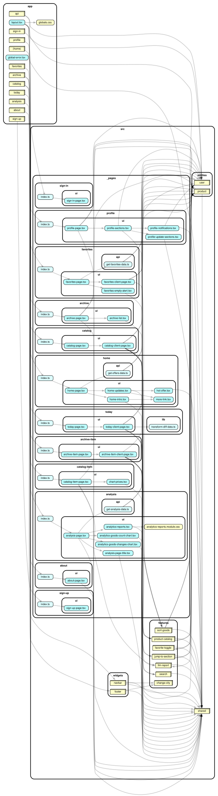

# @dns-markdown/web

Next.js (App Router) frontend/BFF of [dns-markdown](../../README.md), deployed to Vercel. Product, pricelist and analysis data come from the API over HTTP (`API_URL`); auth is handled by Clerk, guest state is stored in Upstash Redis.

## Getting Started

Copy `.env-example` to `.env` and fill in the required variables. Next.js reads env files from `apps/web/`, not the root `.env*` files.

Run the development server from `apps/web/`:

```bash
bun run dev
```

or from the repo root:

```bash
NX_LOAD_DOT_ENV_FILES=false bunx nx run @dns-markdown/web:dev
```

Open [http://localhost:3000](http://localhost:3000) with your browser to see the local site.

Node (used by `next`, `storybook`, `eslint`) is pinned in [`.nvmrc`](../../.nvmrc).

## Scripts

```bash
bun run dev              # dev server (localhost:3000)
bun run build            # production build
bun run start            # start production server

bun run lint             # eslint
bun run lint:fix         # eslint --fix
bun run type-check       # tsc --noEmit

bun run test             # unit tests (bun test --isolate, TZ=UTC)
bun run test:watch       # unit tests in watch mode
bun run test:coverage    # unit tests with coverage

bun run storybook        # storybook dev on :6006
bun run build-storybook  # static storybook build
```

Always use `bun run <script>`: `bun build` is Bun's built-in bundler, not the `build` script.

## E2E tests

Playwright tests live in `playwright/` (config in `playwright.config.ts`). They build and start the app and run against `http://localhost:3000`:

```bash
npx playwright test
```

They require Clerk test credentials and Upstash Redis env vars (see `.github/workflows/playwright.yml` in the repo root).

## Architecture

Code follows [Feature-Sliced Design](https://feature-sliced.design/) under `src/` (`shared → entities → features → widgets`); the Next.js `app/` directory is routing-only. Layer boundaries are enforced by ESLint (`eslint-plugin-boundaries`). See [`CLAUDE.md`](./CLAUDE.md) for details.

## Storybook

Chromatic Storybook is set up for this project: https://www.chromatic.com/library?appId=695938b24c4c7f59436c970b

## Dependency graph

```bash
bun run dep-check       # CI gate: no circular imports
bun run dep-graph       # prints a Mermaid diagram to stdout — paste into a PR/Markdown
bun run dep-graph:archi # renders dependency-graph.svg (needs Graphviz's `dot` locally)
```

Requires Node `^22||^24||>=26` (dependency-cruiser's own supported range) — the project's pinned version ([`.nvmrc`](../../.nvmrc), `v26.7.0`) already satisfies this. See `.dependency-cruiser.cjs` and `CLAUDE.md` for what these rules cover and why.



## Technologies

- Next.js 16, React, TypeScript
- Tailwind CSS, shadcn/ui
- next-intl (i18n)
- TanStack Query, Zustand
- Clerk Auth, Upstash Redis
- Storybook, Chromatic
- Bun test, Playwright
- Sentry
